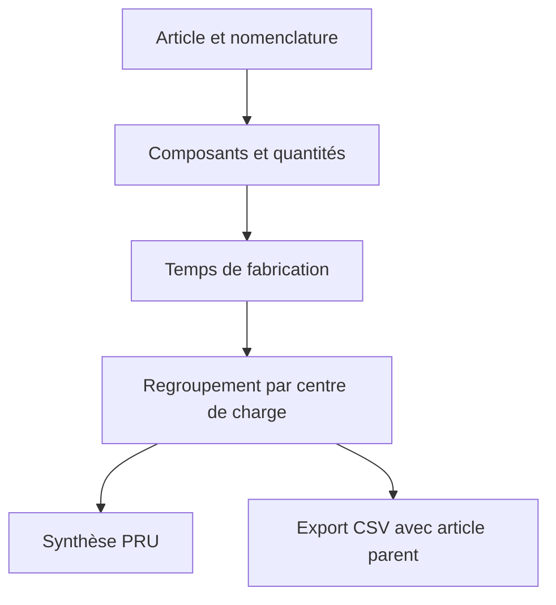
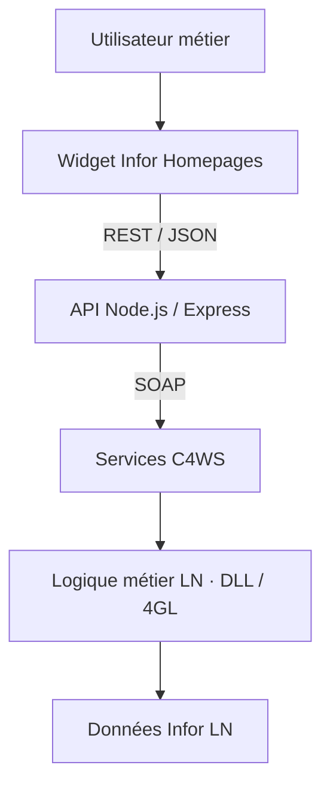
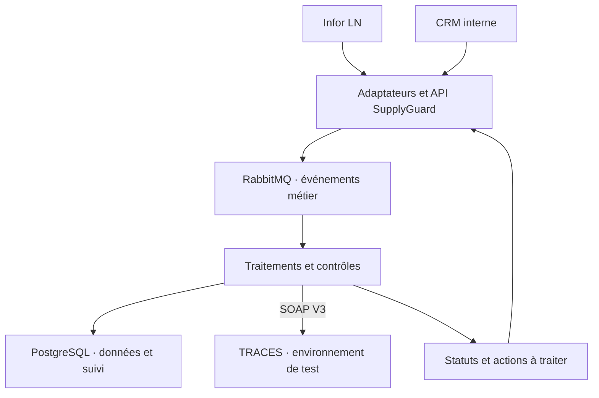

# Djibril Fall

### Développeur full-stack & ERP · Analyse et intégration d’applications métier

**Du besoin métier à une solution exploitable.**

Basé en France, je développe des applications et des intégrations autour des systèmes d’information d’entreprise. Depuis octobre 2024, mon alternance au sein du Groupe Roset — Ligne Roset me permet de travailler sur l’ERP Infor LN, les interfaces web et les échanges de données.

Mon approche : comprendre le processus, préciser le besoin avec les utilisateurs, développer la solution et vérifier son comportement avant sa mise en production.

[LinkedIn](https://www.linkedin.com/in/jbril-fall-52822025b/) · [Me contacter](mailto:falljbril@gmail.com)

---

## Ce que j’apporte à une équipe

- **Analyse métier** : échanges avec les équipes achats, approvisionnement, production et autres utilisateurs de l’ERP.
- **Développement applicatif** : logique métier, interfaces web et traitements de données.
- **Intégration** : connexion de l’ERP aux applications avec des services SOAP et des API REST.
- **Maintenance** : diagnostic d’anomalies et corrections sur des applications existantes.
- **Exploitation** : expérience de déploiement d’API Node.js sur Windows Server avec PM2.

## Réalisations sélectionnées

### 01 — PRU v2 : analyser les coûts et les temps de production

**Contexte :** réalisation en entreprise, dans l’environnement Infor LN.

**Besoin métier**

Produire une synthèse des coûts et des temps de production, avec une lecture par centre de charge et une prise en compte des composants de la nomenclature.

**Ma contribution**

- Développement de la logique de regroupement par centre de charge : couture, menuiserie et coupe, notamment.
- Calcul des temps en tenant compte des quantités de composants.
- Comparaison des résultats avec les données de référence de l’ERP.
- Travail sur un export CSV sans doublons, conservant le lien avec l’article parent.

**Ce que ce projet démontre**

Transformer une règle métier en calcul exploitable, comprendre les relations entre données et contrôler la cohérence d’une restitution.

**Technologies :** Infor LN, 4GL, traitements de données, CSV.

### 02 — Widgets achats et stocks : rendre les données métier lisibles

**Contexte :** réalisations en entreprise autour d’Infor LN et d’Infor Homepages.

**Besoin métier**

Faciliter la consultation des informations d’achat et de stock au moyen d’interfaces adaptées aux utilisateurs.

**Ma contribution**

- Développement de widgets web connectés aux données de l’ERP.
- Travail sur les indicateurs des lignes de commande d’achat : ouvertes, attendues aujourd’hui, en retard et à échéance proche.
- Correction d’un doublon dans la restitution de l’indicateur « En retard ».
- Évolution du widget Stock Neuf avec des règles de filtrage métier.
- Développement d’un widget de nomenclature commerciale.

**Ce que ces projets démontrent**

Concevoir une interface utile, traduire les règles métier en filtres et indicateurs, et assurer la maintenance évolutive d’applications.

**Technologies :** JavaScript, jQuery, interfaces web, Node.js, SOAP, REST, Infor LN / Homepages.

### 03 — Intégration ERP ↔ web : connecter les applications

**Contexte :** développements et exploitation en entreprise.

**Besoin métier**

Permettre à des applications web de consulter des données Infor LN à travers une couche d’intégration.

**Environnement de travail**

Services LN exposés via C4WS/SOAP, couche API Node.js/Express et widgets consommateurs. L’exploitation de l’API s’appuie notamment sur Windows Server et PM2.

**Ma contribution**

- Développement et maintenance de traitements et d’intégrations autour de LN.
- Travail sur la couche API et sa consommation par les widgets.
- Diagnostic de problèmes d’exécution et de gestion du processus Node.js sous Windows.

**Ce que ce projet démontre**

Comprendre une application de bout en bout, depuis les données de l’ERP jusqu’à leur présentation, et intervenir sur ses différents composants.

**Schéma simplifié de l’architecture de travail :**

### 04 — SupplyGuard : projet d’intégration RDUE / EUDR

**Statut : projet personnel en cours de conception et de développement.**

**Objectif**

Concevoir une plateforme d’intégration pour accompagner la collecte des informations fournisseur et la préparation des déclarations de diligence raisonnée, en reliant les applications métier aux services TRACES.

**Travaux engagés**

- Analyse du cycle d’achat et comparaison des déclencheurs possibles : commande approuvée, avis d’expédition et réception.
- Étude des échanges SOAP de l’API V3 et de leurs schémas WSDL/XSD.
- Définition d’une architecture combinant échanges synchrones REST et traitements asynchrones avec RabbitMQ.
- Cadrage d’un MVP autour d’Infor LN et d’un CRM interne.

**Architecture cible — elle ne représente pas un déploiement terminé :**

**Ce que ce projet démontre**

Analyser un processus transverse, concevoir des interfaces entre systèmes et préparer une architecture évolutive en distinguant les objectifs des fonctionnalités effectivement réalisées.

**Technologies envisagées ou étudiées pour ce projet :** Node.js, TypeScript, Express, PostgreSQL, RabbitMQ, Docker, REST, SOAP.

## Compétences techniques

| Domaine | Technologies et pratiques |
| --- | --- |
| Développement full-stack | Node.js, TypeScript, JavaScript, Express, interfaces web |
| ERP et applications métier | Infor LN, 4GL, LN Studio, widgets Infor Homepages |
| Intégration | REST, SOAP, JSON, XML, C4WS, échanges BOD |
| Données | PostgreSQL, traitements et exports CSV |
| Outils de développement et de test | Git, Postman, Swagger, Playwright, Selenium |
| Déploiement et exploitation | Docker, Windows Server, PM2 |
| Architecture étudiée | RabbitMQ, intégration synchrone et asynchrone |

## Parcours

| Période | Formation ou expérience |
| --- | --- |
| Depuis octobre 2024 | Alternance en développement ERP Infor LN — Groupe Roset / Ligne Roset |
| 2025–2027 | Mastère Expert en Développement Full Stack — Ynov Lyon, en cours |
| 2024–2025 | BUT 3 Informatique, parcours Réalisation d’applications — IUT Lyon 1, en alternance |
| Formation antérieure | Licence en Physique Numérique — Sénégal |

## Mon positionnement pour un poste d’analyste-programmeur

Je souhaite contribuer à la conception, au développement et à la maintenance d’applications adaptées aux besoins d’affaires. Mon expérience m’a appris à travailler à l’interface entre les utilisateurs et la technique : comprendre une demande, formaliser une règle métier, connecter les données et faire évoluer une solution existante.

Pour une équipe utilisant Microsoft 365, SharePoint et .NET, j’apporte une expérience transférable en développement d’applications métier et en intégration REST/SOAP. Mon expérience présentée ici porte principalement sur Infor LN et Node.js/TypeScript ; je souhaite élargir ces compétences à l’écosystème Microsoft.

**Disponibilité professionnelle visée : septembre 2027, après mon mastère.**

## Contact

Vous souhaitez échanger sur un besoin de développement ou d’intégration applicative ?

- **E-mail :** [falljbril@gmail.com](mailto:falljbril@gmail.com)
- **LinkedIn :** [Djibril Fall](https://www.linkedin.com/in/jbril-fall-52822025b/)

---

*Les schémas sont des représentations simplifiées. Ce portfolio ne contient ni code propriétaire, ni données internes, ni captures des applications de l’entreprise. Aucun gain chiffré n’est avancé sans mesure vérifiée.*
